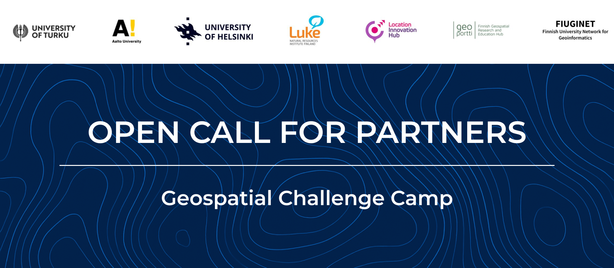

Partners
========

The Geospatial Challenge Camp (GCC) 2027 addresses real-world challenges in **Sustainable Resources Management and Monitoring**
using open data and location technologies. By joining as a partner, your organization can collaborate directly 
with researchers and experts to co-create innovative, data-driven solutions during this camp, taking place from 
February to May 2027.

GCC offers you the opportunity to:

- **Co-create solutions** by guiding multidisciplinary teams as they develop practical, data-driven approaches to the challenges
- **Gain insights from high-value geospatial data** by sharing your datasets with the camp teams for further exploration and solution building
- **Strengthen professional networks** by connecting with talented students, early-career researchers, and experts in geospatial information and sustainable development
- **Showcase expertise and impact** by sharing knowledge, enhancing your organization’s visibility, and contributing to real-world solutions

Partner roles
--------------

As a partner, your organization can contribute expertise, data, and support through the following roles:

.. grid:: 2
    :gutter: 4

    .. grid-item-card:: :fas:`heart` Challenge owner

        Does your organization address real-world challenges in this year’s theme? As a challenge owner, you contribute 
        something valuable: your first-hand knowledge and understanding of the problem. In exchange, you get to see which 
        type of innovative solutions the teams end up with during the process.

    .. grid-item-card:: :fas:`database` Data provider

        Does your organization possess digital location data related to this year’s theme? Would you be willing to 
        make this data available for research and innovation?

.. grid:: 2
    :gutter: 4

    .. grid-item-card:: :fas:`globe` Policy maker

        Does your organization face information gaps for improved decision-making in this year’s theme area? Are you 
        interested in linking data-driven insights with sustainable policy development?

    .. grid-item-card:: :fas:`zap` Financial sponsor

        Is your organization interested in supporting the Geospatial Challenge Camp by contributing to operational costs, 
        such as venue, catering, or the social program? Would you like to provide  scholarships or awards for outstanding
        solutions by early-career researchers?

Possible Partners
------------------
- Organizations and institutes working in **natural resource management, monitoring, or sustainability-oriented innovation**
- Providers of **location-based or statistical data and services**
- Companies aiming to **develop or enhance sustainable and data-driven operations**
- **Innovation hubs, accelerators, and startups**, especially focused on environmental or geospatial solutions
- **Public sector bodies, NGOs, and non-profits** addressing natural resource management, monitoring, or environmental challenges
- **Cities, municipalities, and regional governments** exploring applied solutions for natural resources
- **Research groups and academic institutions** exploring applied solutions for natural resources
- **Motivated individuals, volunteers, or citizen science networks** contributing to the theme

Sign up
-------
We will contact all respondents shortly after reviewing the forms.

.. attention::

    Partner registration is now open.
    
    .. button-link:: https://forms.gle/VGGCa5fjfvVqVziJ6
            :color: primary
            :shadow:
            :align: center

            👉 Register using this form

Contact us
----------

.. grid:: 1

    .. grid-item-card::

        For questions or further information, please contact us by email at **geospatial-challenge@utu.fi**