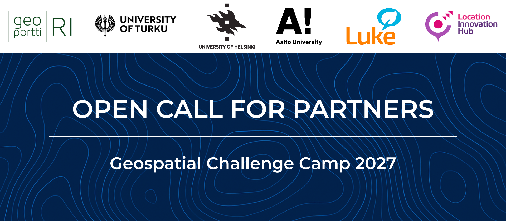

Partners
========

Is your organization looking for solutions? The Geospatial Challenge Camp addresses real-world sustainable challenges in 
**Theme** using open data and location technologies. By joining as a partner, your organization can 
collaborate directly with researchers and experts to co-create innovative, data-driven solutions during this 12-week course 
taking place from February to May 2026.

Sign up
-------
We will contact all respondents shortly after reviewing the forms.

.. attention::

    Partner registration opens soon!

We offer the opportunity to:
--------

- **Co-create and test solutions** by guiding multidisciplinary teams as they develop practical, data-driven approaches
- **Gain insights from high-value geospatial data** by exploring diverse datasets and using advanced analysis tools
- **Strengthen professional networks** by connecting with talented students, early-career researchers, and experts in geospatial information and sustainable development
- **Showcase expertise and impact** by sharing knowledge, enhancing your organization's visibility, and contributing to real-world solutions

Partner activities
-------------------

By joining as a partner, your organization can contribute expertise, data, and support through the following roles:

.. grid:: 2
    :gutter: 4

    .. grid-item-card:: :fas:`heart` Challenge theme owners

        Does your organization address real-world challenges in Theme?
        Would you like to collaborate with multidisciplinary teams using open data and location-based technologies to develop practical solutions?

    .. grid-item-card:: :fas:`database` Digital data providers

        Does your organization possess digital Theme location data?
        Would you be willing to make this data available for research and innovation?

.. grid:: 2
    :gutter: 4

    .. grid-item-card:: :fas:`globe` Policy makers

        Does your organization face information gaps in Theme for improved decision-making?
        Are you interested in linking data-driven insights with sustainable policy development?

    .. grid-item-card:: :fas:`zap` Financial sponsors

        Is your organization interested in supporting the Geospatial Challenge Camp by contributing to operational costs, such as venue, catering, or the social program?
        Would you like to provide scholarships or awards for outstanding solutions by early-career researchers?

Possible partners
-----------------

- Organizations and institutes working in Theme, or sustainability-oriented innovation
- Organizations providing location-based or statistical data and services
- Regional authorities and service providers
- Companies aiming to develop or enhance sustainable and data-driven operations
- Innovation hubs and actors
- Public sector bodies and NGOs addressing transport, accessibility, or environmental challenges
- Cities, municipalities, and provinces
- Motivated individuals and volunteers interested in contributing to the theme

Contact us
----------

.. grid:: 1

    .. grid-item-card::

        For questions or further information, please contact us by email at **geospatial-challenge@helsinki.fi**